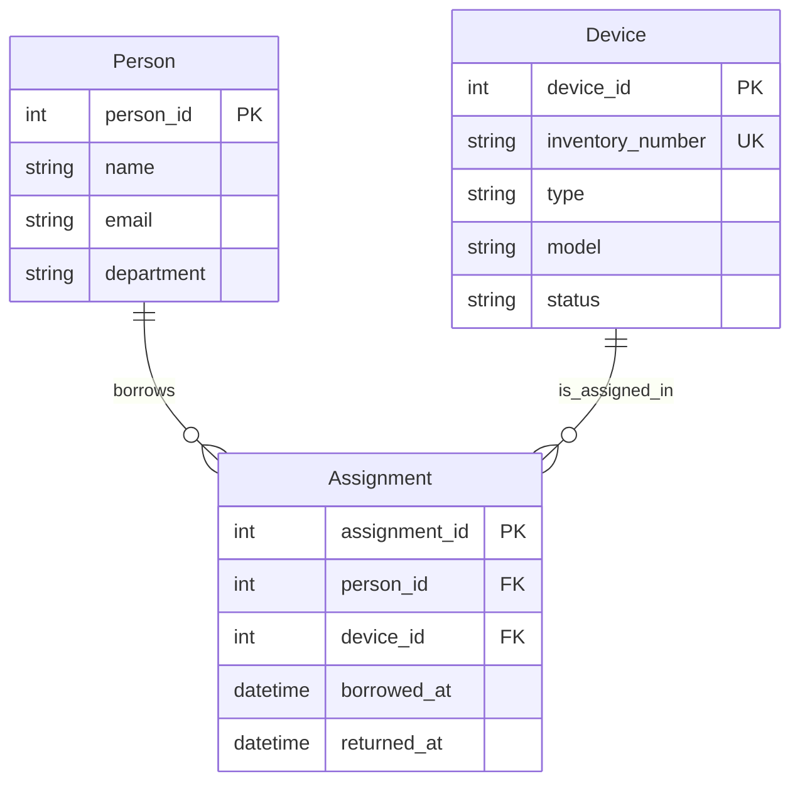

# Datenmodell – Geräteausleihe

## ER-Diagramm

## Fachregeln

1. Eine Person kann mehrere Geräte gleichzeitig ausleihen.
2. Ein Gerät kann über die Zeit mehrfach ausgeliehen werden.
3. Ein Gerät darf maximal eine aktive Ausleihe haben.
4. Eine Ausleihe gilt als aktiv, wenn `returned_at = NULL` ist.
5. Das Rückgabedatum darf nicht vor dem Ausleihdatum liegen.
6. Jede Ausleihe gehört genau einer Person und einem Gerät.
7. Jede Inventarnummer muss eindeutig sein.
8. Geräte dürfen nur ausgeliehen werden, wenn sie verfügbar sind.
9. Vergangene Ausleihen bleiben für die Historie gespeichert.
